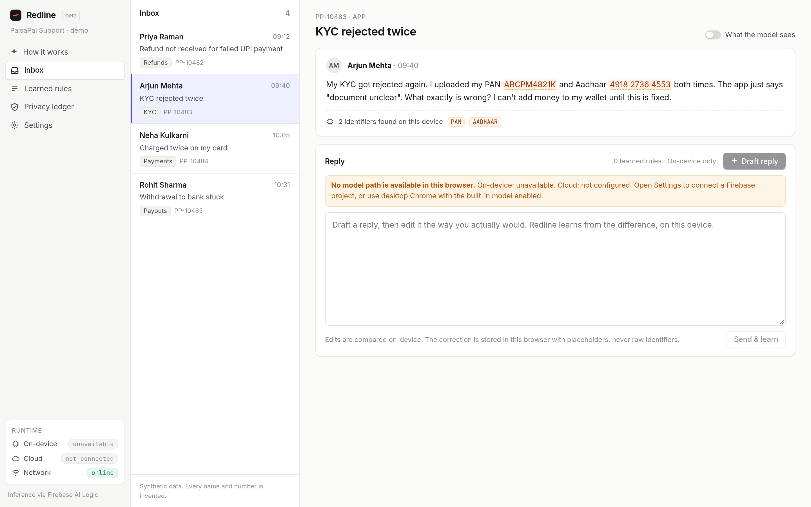

# Redline

**A support reply assistant that learns from your corrections without your corrections leaving the device.**

Built for **#BuildHybridAI 2026** with the **Firebase AI Logic** Web SDK (hybrid on-device + cloud inference). Platform: **Web (desktop Chrome)**.

**Live app:** https://shine-5705.github.io/redline/ · **License:** MIT



---

## The problem

Support agents at Indian fintechs fix AI-drafted replies all day. They soften a promise, add the dispute ID, remove a line that asks for a full card number. Those edits are the best training signal a team has. They are also full of customer data: Aadhaar, PAN, UPI IDs, card numbers, phone numbers.

Teams end up with two bad options. They can ship every edit to a cloud model and a fine-tuning pipeline, which is a compliance problem. Or they throw the edits away, so the AI makes the same mistake tomorrow.

## What Redline does

1. **Redacts on-device, before any prompt exists.** A deterministic detector finds Aadhaar numbers (Verhoeff check digit), PAN, UPI IDs, card numbers (Luhn), IFSC codes, Indian phone numbers, emails, account numbers and the customer's name. It swaps each one for a placeholder such as `[UPI_1]`, and the original values stay in an in-memory vault in the tab.
2. **Drafts with hybrid inference.** Drafting uses `InferenceMode.PREFER_ON_DEVICE`. Gemini Nano runs in Chrome when it is available, and `gemini-3.5-flash-lite` runs through Firebase when it isn't. Each draft shows which path ran, read from the SDK's `inferenceSource`, along with the latency, how many characters left the device, and an independent re-scan count of identifiers in the prompt.
3. **Captures the correction.** When the agent edits and presses **Send & learn**, Redline re-tokenises the final text with the same vault and computes a word-level diff. It stores the correction in IndexedDB as placeholders only.
4. **Learns on-device only.** The diff is distilled into one reusable rule by a separate `ONLY_ON_DEVICE` model instance, using Prompt API structured output (`responseConstraint` with a JSON schema). Example rule: "Give the dispute ID and a 48-hour timeline instead of promising a same-day refund."
5. **Gives the cloud nothing by default.** If no on-device model is available, the correction is **held on the device**. The agent can then do one of three things:
   - write the rule themselves;
   - leave it held;
   - explicitly opt in to send *that one redacted diff* to the cloud model (`ONLY_IN_CLOUD`).
6. **Uses learned rules on every later draft.** Active rules are added to the next draft's prompt. The Privacy ledger shows words edited per reply, early replies against later ones, measured from real corrections.
7. **Promotes by choice.** A rule joins the shareable team playbook only after the agent sees the exact JSON payload, an on-device re-scan shows 0 identifiers, and the agent ticks an approval box. The playbook can be exported and imported as JSON.
8. **Keeps a privacy ledger.** Every model call is recorded with its feature, requested mode, the path that actually ran, the model, the latency, the characters sent off-device, the identifiers redacted and the identifiers in the prompt. The ledger can be exported to CSV.

## Why hybrid matters here

| Feature | Inference mode | Why |
|---|---|---|
| Draft a reply | `PREFER_ON_DEVICE` (or `ONLY_ON_DEVICE` in Local-only mode or when offline) | It works on every laptop, and it is free and private where Nano exists. Prompts contain only placeholders, so the cloud fallback is safe. |
| Learn a rule from a correction | `ONLY_ON_DEVICE` | Corrections are the most sensitive data the team has. |
| Learn a rule in the cloud | `ONLY_IN_CLOUD`, **only after a per-correction opt-in** | It is an escape hatch for devices without Nano, and it is the agent's decision. |

## Architecture

```
 Browser (desktop Chrome)                                   Firebase
 ┌──────────────────────────────────────────┐              ┌──────────────────────────────┐
 │ Ticket ──► PII detector (Verhoeff, Luhn, │              │ App Check (reCAPTCHA v3 /    │
 │            regex, customer name)         │              │ Enterprise, debug tokens)    │
 │              │                           │ placeholders │                              │
 │              ▼                           │ only         │ Firebase AI Logic            │
 │ Vault  ◄── redact ──► prompt ──► firebase/ai ─────────► │  Gemini Developer API        │
 │   │                       PREFER_ON_DEVICE│             │  gemini-3.5-flash-lite       │
 │   │                         │             │             └──────────────────────────────┘
 │   │                         ▼             │                      ▲
 │   │                 Gemini Nano (Prompt API)                     │ opt-in, one redacted diff
 │   ▼                                       │                      │
 │ rehydrate ─► agent edits ─► diff ─► ONLY_ON_DEVICE distill ──────┘ (ONLY_IN_CLOUD)
 │                                  │                                │
 │ IndexedDB: corrections · rules · privacy ledger                    │
 └──────────────────────────────────────────┘
```

Code map:

- `src/lib/engine.ts`: every Firebase AI Logic call. It handles `initializeApp`, App Check, `getAI(GoogleAIBackend)`, the four `getGenerativeModel` instances, `inferenceSource`, and the on-device availability check and download.
- `src/lib/pii.ts`: detection, redaction, rehydration and the leak re-scan.
- `src/lib/prompts.ts`: the draft and distillation prompts, plus the word diff.
- `src/components/*`: Inbox, Learned rules, Privacy ledger, Settings and How it works.
- `src/lib/__tests__/pii.test.ts`: unit tests (Vitest).
- `e2e/mock_prompt_api_test.py`: a wiring test that drives the real app and the real Firebase AI Logic SDK against a **mocked** `window.LanguageModel`.

## What's real (and what isn't)

**Real**
- All inference goes through the Firebase AI Logic Web SDK (`firebase/ai`, v13.4.0), imported and called in `src/lib/engine.ts`. No other model API is called.
- The on-device path is Chrome's built-in model via the SDK's Prompt API adapter. The cloud path is the Gemini Developer API via Firebase, behind App Check.
- The source label on every draft and ledger row comes from `response.inferenceSource`. Redline doesn't guess it.
- Redaction, the diff, IndexedDB storage, the leak re-scan, opt-in gating and the playbook export all run in the browser, and you can read the code.
- Every number in the UI is measured in your browser at runtime.

**Not real, or limited**
- The tickets are **synthetic**. The company ("PaisaPal"), the names and the numbers are invented. Aadhaar-format numbers are random digits with a valid Verhoeff check digit.
- The team playbook is a JSON export and import, not a live shared backend. Firestore sync is on the roadmap.
- The PII detector is rule-based. It can miss free-form identifiers such as street addresses or names other than the customer's. Redline re-scans every prompt and blocks the call if a known identifier survives, but that isn't a guarantee for unknown formats.
- On-device inference needs desktop Chrome 139+ on supported hardware, with the built-in model enabled. Elsewhere, drafts use the cloud and learning waits for the agent's opt-in.
- There are no user numbers or benchmarks. This is a new hackathon project started 17 Nov 2026.

## Run it

```bash
npm ci
npm run dev        # http://localhost:5173
npm test           # unit tests
npm run build && npx vite preview --port 4173 && npm run e2e   # mocked Prompt API wiring test
```

### Connect Firebase (cloud fallback)

1. Create a Firebase project (the Spark plan is enough) and add a **Web app**.
2. **AI Logic → Get started → Gemini Developer API.**
3. **App Check → register the web app with reCAPTCHA v3** (or Enterprise), then enforce it for Firebase AI Logic. For local testing, add a debug token and open the app with `?appcheck_debug=<token>`.
4. Copy `public/firebase-config.example.json` to `public/firebase-config.json` and fill in the web config and site key. Web config values are not secrets; never commit debug tokens or service-account keys. Alternatively, paste the JSON into **Settings** in the running app; it is stored only in that browser.

### Enable on-device (Gemini Nano in Chrome)

Use desktop Chrome 139 or later. Enable `chrome://flags/#prompt-api-for-gemini-nano-multimodal-input` and restart Chrome. Redline's Settings page shows the model status and has a **Download on-device model** button when the status is `downloadable`.

### Deploy

- **GitHub Pages:** handled by `.github/workflows/pages.yml` on every push to `main`.
- **Firebase Hosting:** `npm run build && firebase deploy --only hosting`. `firebase.json` is included.

## Built during the submission period

Redline was built from scratch, starting 17 Nov 2026, after submissions opened on 11 Nov 2026. It contains no pre-existing code beyond open-source dependencies: Firebase JS SDK, React, Vite, `diff`, `idb`, and the Inter and JetBrains Mono fonts. AI coding assistance was used.

## License

MIT © 2026 Shine Gupta
